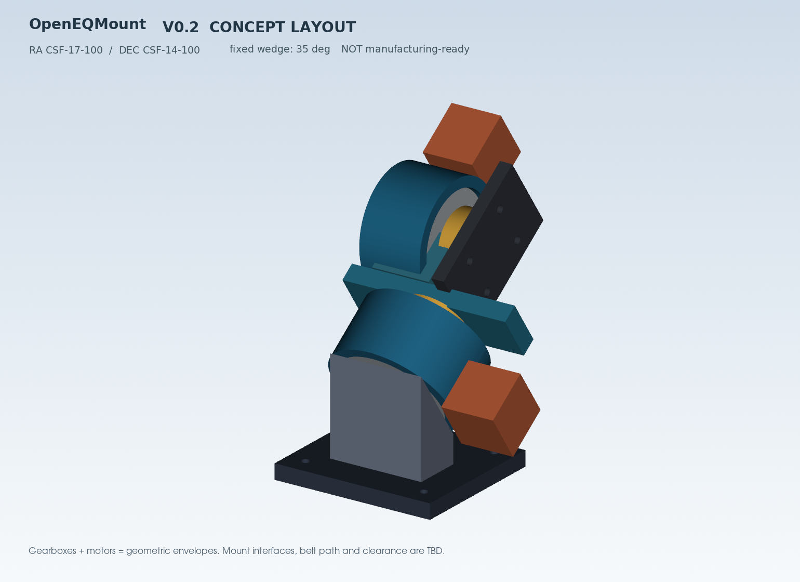

# OpenEQMount — 开源双轴摄影赤道仪

**当前版本：V0.3 / DfAM 受控 FDM 打印试装原型，尚未经过真实负载与安全验证。**

用途已经确定：**广角星野摄影；目标摄影载荷 3–5 kg；最长焦距 ≤500 mm**。这些属于研发目标，不是量产参数或已确认的安全载荷。项目以德式双轴赤道仪 (GEM) 为基础，拟使用 RA/DEC 独立谐波减速器 + 3:1 同步带传动，第一阶段优先兼容 OnStepX 生态。


## DfAM 强制机械设计规范（2026-10-18 生效）

**全部未来 3D 打印零件必须按 [DfAM 设计规范](docs/dfam-design-standard.md) 建模、检查和归档**：先确定打印方向和各层载荷，再设计可自支撑的悬垂、低应力集中圆角/筋板、金属贯穿承力连接、按打印机标定的配合公差以及维修拆装空间。

V0.3 已重构电机耳板的圆角/XY 面加强筋和部分 M4 金属贯穿连接，STL 自动落在 Z=0，生成 `manifest.json` 中逐件 DfAM 记录，使用 `tools/dfam_gate.py` 进行网格、尺寸和受控资料检查。**自动 Gate A 通过并不代表打印支撑、强度或 3–5 kg 载荷认证；Gate B 切片/实物配合及 Gate C 载荷与安全测试仍待完成。**

```bash
python -m pip install 'cadquery>=2.5,<3' pytest trimesh
python hardware/cad/generate_v03.py --out hardware/cad/v03_generated
python tools/dfam_gate.py --report hardware/cad/v03_generated/dfam-gate-report.json
python -m pytest -q
```

**V0.2 的旧 STL 属于不符合本 DfAM 发放流程的外形概念，不再随正式仓库/Actions 作为打印文件发布**；保留 V0.2 STEP 与可编辑源代码用于历史回溯。

## V0.2 机械选型

| Axis | Candidate reducer | Rated output torque | Output bearing moment | Nominal outline |
|--|--|--:|--:|--|
| RA | CSF-17-100-2UH | 24 Nm | 64 Nm | Ø79 x 45 mm |
| DEC | CSF-14-100-2UH | 7.8 Nm | 41 Nm | Ø73 x 41 mm |

Both have 100:1 ratios and integrated crossed-roller output bearings. Official source [CSF reducer catalogue](https://www.harmonicdrive.net/products/gear-units/gear-units/csf-2uh). Actual drive/bracket interfaces **are NOT yet in CAD**.

## V0.2 CAD preview



The `hardware/cad/` folder contains **editable CadQuery Python source**, separate STEP components, a combined STEP conceptual assembly and three PNG previews. **Legacy V0.2 concept STLs are no longer distributed as print files.** V0.2 shows a **fixed** parametric latitude wedge at 35°, reconfigurable at generation to 25–60°; a functional, continuously adjustable polar wedge remains to be designed.

## Quick start

```bash
python -m unittest discover -s tests -v
python tools/mount_sizing.py
python tools/motion_math.py
pip install 'cadquery>=2.5,<3'
python hardware/cad/generate_v02.py --latitude 35 --out hardware/cad/generated
```

`cad-build.yml` rebuilds concept STEP/STL and uploads them as **GitHub Actions artifacts**, not as machining-ready parts. For rendered local previews, install VTK and run `xvfb-run -a python tools/render_cad_preview.py` on Linux.

### Engineering files

- [V0.2 calculations, reducer choice, and design gates](docs/mechanical-v02.md)
- [Parametric CAD source](hardware/cad/generate_v02.py) / [editable dimensions](hardware/cad/params.py)
- [V0.2 initial bill of materials](hardware/bom/bom-v02.csv)
- [V0.1 project architecture](docs/architecture.md) / [test plan](docs/test-plan.md) / [roadmap](docs/roadmap.md)
- [Motor ratio / angular-step calculator](tools/motion_math.py)

## Safety and design status

This is **NOT a functional mount**. There are no verified fastener patterns or tolerance fits, belt routing and tensioner geometry, lat/az moving adjuster, collisions, camera clamp, counterweight/brake, power-loss retention, or real tracking-error measurements. Do **not** use CAD output to mount valuable camera equipment without redesign, analysis and bench testing. The strain-wave gear cannot be assumed to self-lock. A 0.3375 arcsec commanded microstep is NOT physical tracking accuracy.

No vendor CAD or third-party source is included. Hardware/software open-source license selection is pending and should be completed before third-party redistribution.

## V0.3 — 3D printed reducer interface prototypes (2026-10-18)

> ⚠️ These are **bench-fit prototypes ONLY**. The RA–DEC load-carrying joint, wave-generator input shafts, adjustable polar wedge and tripod clamp are **not implemented or safety/load-verified**. Do not attach an optical payload or run powered GoTo.

For 3–5 kg target starfield cameras <=500 mm focal length, V0.3 designs individual
printable RA CSF-17 and DEC CSF-14 OEM 2UH interfaces:

- rear mounting housing with factory bolt patterns (RA PCD71, DEC PCD65, 6×M4 each), clearance sleeve
- output bolt adapters (RA PCD27 6×M5, DEC PCD23 6×M4) with counterbored screw pockets
- NEMA17 slotted motor carriages with 31×31mm mounting holes and ±5mm belt adjustment
- optional input shaft bearing bridge (for verified input shaft design **only**)
- printer tolerance coupons for reducer bores and 608/626 auxiliary bearing fits

**START HERE:** [`docs/mechanical-v03-3dprint.md`](docs/mechanical-v03-3dprint.md).

```bash
python -m pip install 'cadquery>=2.5,<3' pytest
python -m pytest -q tests/test_v03_mechanics.py
python hardware/cad/generate_v03.py --out hardware/cad/v03_generated
```

BOM: [`hardware/bom/bom-v03-print.csv`](hardware/bom/bom-v03-print.csv).
CAD: [`hardware/cad/generate_v03.py`](hardware/cad/generate_v03.py).
Automation: [`.github/workflows/cad-v03.yml`](.github/workflows/cad-v03.yml).


## V0.4 — DfAM 正交 RA–DEC 连接框架（Gate A）
V0.4 已提供 5 个 FDM 平放打印的非承力盖板/公差工具、8 个**金属承力结构参考 STEP**、RA/DEC 90° 连接装配 STEP、CAD 参数化生成器、BOM、测试与 GitHub Actions 自动构建。打印零件不承受减速器的主承力/防坠载荷。
- [V0.4 机械结构与安全边界](docs/mechanical-v04-frame.md)
- [V0.4 生成器](hardware/cad/generate_v04.py)
- [V0.4 数字 DfAM Gate A](tools/dfam_gate_v04.py)
- [V0.4 构建工作流](.github/workflows/cad-v04.yml)
- [已生成 V0.4 STEP/STL](hardware/cad/v04_generated)

**仍为 bench-fit 原型；3–5 kg 只是研发目标，不得加载摄影器材。** 需采购实物验证厂家孔位、打印测试 Gate B、力学及失效保护 Gate C 后才能评估野外使用。


## V0.5 — Adjustable Polar Wedge (Gate A, not load rated)

- Parameterized latitude trial **25–45°** and azimuth slot ±5°; kinematic metal base, twin hinge ears and reference jack.
- **5 nonstructural DfAM printed** covers/gauges/scale; **10 metal reference** parts. NO load-rated altitude lock, fail-safe or tripod interface yet.
- Warning: DO NOT attach the *rotating* V0.4 RA output plate to the wedge. A separate **fixed RA stator housing adapter** must be engineered.
- [V0.5 engineering notes](docs/mechanical-v05-polar-base.md) · [BOM](hardware/bom/bom-v05-polar-base.csv) · [CAD generator](hardware/cad/generate_v05.py) · [Gate A model outputs](hardware/cad/v05_generated/)
- `python -m pytest -q tests/test_v05_polar_wedge.py` and `python tools/dfam_gate_v05.py --dir hardware/cad/v05_generated`.

**V0.5 is a bench-fit research model; no photography or external load until Gate B/C verification, metal locks and safety restraint.**


## V0.6 安全锁紧原型

- 新增独立的金属纬度锁紧和限位销槽，供 25°–45° 可调极轴底座进行**无载荷试装**。
- 新增可替换的 Ø146 mm 金属三脚架转接板（Ø10.5 / Ø10.0 中心通孔为候选值，**未验证任何具体三脚架型号**）。
- DfAM 新增 4 件非承力打印件，附参数化 CAD、STEP/STL、BOM、8 项数字测试与 Gate A 工作流。
- 详见 [V0.6 机械设计及待验证项目](docs/mechanical-v06-safety-lock.md)。**当前不可带摄影载荷使用。**

## V0.7 RA 固定端连接 + 双轴同步带台架（DfAM Gate A）

- **RA 固定机壳端**新增可修改金属转接结构：重新开孔的极轴顶板、两层金属立柱、固定端后法兰。不能与旋转输出端混用；孔位角度必须按真实减速器校验。
- RA、DEC 分别新增未连接到减速器的 **GT2 60T/20T 同步带台架参考模型**（3:1，中心距 115±5mm）；波发生器输入轴、实际联轴器、轴承和皮带都**尚未设计/确认**。
- 3 件不承力的 DfAM 打印检具；完整源代码、STEP/STL、自动化测试和 Gate A 检查。详情：[V0.7 设计说明](docs/mechanical-v07-ra-stator-and-belt-bench.md)。
- **安全声明：数字几何原型，禁止载荷与通电测试；Gate B/C 尚未完成。**


## V0.8 — 单文件整机概念装配预览（FreeCAD）

- [下载包含 V0.4–V0.7 主要已定位子结构的整机 STEP](hardware/cad/v08_generated/OpenEQMount_V08_WHOLE_MOUNT_CONCEPT_UNQUALIFIED.step)
- [查看整机预览 PNG](hardware/cad/v08_generated/OpenEQMount_V08_WHOLE_MOUNT_CONCEPT.png)
- [Windows FreeCAD 打开说明及安全边界](docs/mechanical-v08-combined-view.md)

此整机 STEP 仅为位置参考，不可用于制造、3D 打印整机或挂载设备。尚未完成真实电机输入、皮带传动对接和载荷验证。
